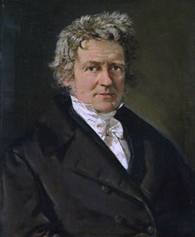

```{r loadpacksdescriptivesvarability}
#| include: false
#| cache: false
source("loader.R")
```

## Measures of Variability

### Variability of Nominal Variables

For most purposes, the visual inspection of a frequency distribution table or bar plot is all that is needed to understand a nominal variable's variability. I have never needed a statistic that measures the variability of a nominal variable, but if you need one, there are [many from which to choose](https://en.wikipedia.org/wiki/Qualitative_variation). For example, @wilcoxIndicesQualitativeVariation1973 presented this analog to variance for nominal variables:

$$
\text{VA} = 1-\frac{1}{n^2}\frac{k}{k-1}\sum_{i=1}^k\left(f_i-\frac{n}{k}\right)^2
$$

The qualvar package [@R-qualvar] can compute the primary indices of qualitative variation presented by Wilcox.

```{r fig-nominalvar}
#| fig-cap: "The Variance Analog (VA) index of qualitative variation ranges from 0 to 1. It equals 0 when every data point is assigned to the same category and 1 when each category has the same frequency."
#| fig-height: 7
#| out-width: "400"
#| fig-column: margin
#| fig-align: left
# The Variance Analog (VA) index of qualitative variation
low_var <- c(A = 100, B = 0, C = 0, D = 0)
mid_var =  c(A = 60, B = 10, C = 25, D = 5)
high_var = c(A = 25, B = 25, C = 25, D = 25)


tibble(
  Variability = c("Low", "Middle", "High"),
  Frequency = list(low_var, mid_var, high_var),
  VA = map_dbl(Frequency, VA)
) %>%
  mutate(
    Frequency = map(Frequency, function(d)
      as.data.frame(d) %>%
        tibble::rownames_to_column("Category")),
    Variability = paste0(Variability,
                         "\nVA = ",
                         prob_label(VA)) %>%
      fct_inorder()
  ) %>%
  unnest(Frequency) %>%
  rename(Frequencies = d) %>%
  ggplot(aes(Category, Frequencies)) +
  geom_col(aes(fill = Variability)) +
  geom_richlabel(
    aes(label = Frequencies),
    vjust = 0,
    label.margin = margin(),
    label.padding = margin(b = .5, t = .5, l = .5, r = .5),
    color = "gray30",
    text_size = 30
  ) +
  scale_y_continuous(
    expand = expansion(mult = c(0, 0.08)),
    breaks = seq(0, 100, 20),
    minor_breaks = seq(0, 100, 10)
  ) +
  scale_fill_manual(values = myfills) +
  facet_grid(cols = vars(Variability)) +
  theme_light(base_family = bfont, base_size = 30) +
  theme(panel.grid.major.x = element_blank(),
        legend.position = "none")
```

```{r demo-qualvar}
library(qualvar)

# Frequencies
frequencies =  c(A = 60, B = 10, C = 25, D = 5)

# VA
VA(frequencies)
```


In all of these indices of qualitative variation, the lowest value is 0 when every data point belongs to the same category (See @fig-nominalvar, left panel). Also, the maximum value is 1 when the data points are equally distributed across categories (See @fig-nominalvar, right panel).

```{r coder-fig-nominalvar}
<<fig-nominalvar>>
```


### Interquartile Range

As with nominal variables, a bar plot or frequency distribution table can tell you most of what you want to know about the variability of an ordinal variable. If you need a quantitative measure of how much an ordinal variable varies, you have many options. The most important of these is the [interquartile range]{.defword title="The **interquartile range** (IQR) is the distance from the score at the 25th percentile to the score at the 75th percentile."}.

```{r fig-normalIQR}
#| fig-cap: "In a normal distribution with a mean of 100 and a standard deviation of 15, the interquartile range is about 20.2, the distance between 89.9 and 110.1."
#| fig-column: margin
#| fig-align: left
IQR_bounds <- qnorm(c(.25, .75), mean = 100, sd = 15)
l_height = .05
ggplot(data = tibble(x = c(40, 160), y = pnorm(x, 100, 15)), aes(x)) +
  stat_function(fun = \(x) dnorm(x, 100, 15),
                geom = "area",
                alpha = 0.1) +
  stat_function(
    fun = \(x) dnorm(x, 100, 15),
    geom = "area",
    xlim = qnorm(c(.25, .75), mean = 100, sd = 15),
    fill = myfills[1],
    alpha = 0.5
  ) +
  scale_y_continuous(NULL, breaks = NULL, expand = expansion()) +
  scale_x_continuous(NULL, breaks = seq(40, 160, 15)) +
  theme_minimal(base_size = 28, base_family = bfont) +
  theme(
    panel.grid.major.x = element_blank(),
    panel.grid.minor.x = element_blank(),
    axis.ticks.x = element_line(color = "gray30"), plot.margin = margin()
  ) +
  annotate(
    x = IQR_bounds,
    y = 0,
    size = ggtext_size(28),
    geom = "richtext", label.color = NA, fill = NA,
    label = paste0("**", round(IQR_bounds, 1),"**<br><span style='font-size:22pt'>", c(25, 75), "<sup>th</sup><br>percentile"),
    hjust = c(1, 0),
    lineheight = .9,
    vjust = 0
  ) + 
  geom_arrow_segment(
    data = tibble(
      x = IQR_bounds[1], 
      y = 0, 
      xend = IQR_bounds[2], 
      yend = 0),
    aes(x = x, y = y, xend = xend, yend = yend),
    arrow_head = my_arrowhead,
    arrow_fins = my_arrowhead
    ) +
  annotate(x = 100, 
           y = 0,
           size = ggtext_size(28),
           label = paste0("*IQR*<br>=", round(IQR_bounds[2] - IQR_bounds[1], 1)),
           geom = "richtext", fill = NA, label.color = NA,
           vjust = 0) + 
  coord_cartesian(clip = "off")
  
```


When median is a good choice for our central tendency measure, the interquartile range is usually a good choice for our variability measure. Whereas the median is the category that contains the 50th percentile in a distribution, the interquartile range is the distance between the categories that contain the 25th and 75th percentile. That is, it is the range of the 50 percent of data in the middle of the distribution. For example, in @fig-normalIQR, the shaded region is the space between the 25th and 75th percentiles in a normal distribution. The IQR is the width of the shaded region, about 20.2.

```{r coder-fig-normalIQR}
<<fig-normalIQR>>
```

In ordinal data, there is no distance between categories, thus we cannot report the interquartile range *per se*. However, we can report the categories that contain the 25th and 75th percentiles. In @fig-ordinalIQR, the interquartile range has its lower bound at *Disagree* and its upper bound at *Slightly Agree*."

```{r fig-ordinalIQR}
#| fig-cap: "In this ordinal variable, the interquartile range has a lower bound at *Disagree* (which contains the 25th percentile) and an upper bound at *Slightly Agree* (which contains the 75th percentile)."
#| fig-width: 3.5
#| out-width: "300"
#| fig-column: margin
#| fig-align: left
d <- tibble(
  Agreement = c(
    "Strongly Disagree",
    "Disagree",
    "Slightly Disagree",
    "Slightly Agree",
    "Agree",
    "Strongly Agree"
  ),
  n = c(23, 85, 93, 121, 20, 26),
  p = n / sum(n),
  cp = cumsum(p),
  ymin = lag(cp, default = 0),
  ytext = ymin + p / 2
)

d %>%
  mutate(Agreement = fct_inorder(Agreement) %>% fct_rev()) %>%
  ggplot(aes(p, cp)) +
  geom_rect(aes(
    ymin = ymin,
    ymax = cp,
    xmin = 0,
    xmax = 1,
    fill = Agreement
  )) +
  geom_label(
    aes(x = 1, label = paste0(round(cp * 100), "%")),
    hjust = 0,
    linewidth = 0,
    color = "gray30"
  ) +
  geom_text(
    aes(
      x = 0.5,
      y = ytext,
      label = paste0(Agreement,
                     " (",
                     round(100 * p), "%)")
    ),
    size = WJSmisc::ggtext_size(18),
    color = "gray10"
  ) +
  scale_y_continuous(
    "Cumulative Proportion",
    minor_breaks = NULL,
    labels = \(x) paste0(round(x * 100), "%"),
    expand = expansion(),
    limits = c(0, 1)
  ) +
  scale_x_continuous("Agreement", breaks = NULL, expand = expansion(add = c(0, .2))) +
  scale_fill_manual(values = rev(c(
    rev(tinter(myfills[1], steps = 4)[1:3]),
    tinter(myfills[2], steps = 4)[1:3]
  ))) +
  theme(
    legend.position = "none",
    axis.ticks.y = element_line("gray30"),
    panel.grid.major.y = element_blank()
  ) +
  coord_cartesian(clip = "off")
```

```{r coder-fig-ordinalIQR}
<<fig-ordinalIQR>>
```

The median and the interquartile range are displayed in box and whiskers plots like @fig-IQRboxplot. The height of the box is the interquartile range, and the horizontal line is the median. The top "whisker" extends no higher than 1.5 × *IQR* above the 75th percentile. The bottom "whisker" extends no lower than 1.5 × *IQR* below the 25th percentile. Any data points outside the whiskers can be considered outliers.

```{r fig-IQRboxplot}
#| fig-cap-location: top
#| fig-cap: "A Tukey-style Box and Whiskers Plot with Medians and Interquartile Ranges."
#| fig-width: 8
#| fig-height: 7
set.seed(2)
d <-
  tibble(
    A = rnorm(100, 50, 10),
    C = 1.5 * rchisq(100, 4) + 50,
    B = rbeta(100, 4.5, .5) * 80
  ) %>%
  pivot_longer(cols = everything(),
               names_to = "grp",
               values_to = "x") %>%
  mutate(grp = factor(grp)) %>%
  group_by(grp) %>%
  mutate(
    md = median(x),
    IQR = IQR(x),
    q25 = quantile(x, .25),
    q75 = quantile(x, .75)
  ) %>%
  ungroup() %>%
  mutate(outlier = ifelse(x > md,
                          x - q75 > IQR * 1.5,
                          q25 - x >  IQR * 1.5))

d_stats <- d %>%
  group_by(grp) %>%
  summarise(md = median(x),
            q25 = quantile(x, .25),
            q75 = quantile(x, 0.75)) %>%
  pivot_longer(cols = -grp,
               names_to = "stats",
               values_to = "x") %>%
  mutate(
    st = case_when(
      stats == "md" ~ " (Median)",
      stats == "q25" ~ " (1<sup>st</sup> Quartile)",
      stats == "q75" ~ " (3<sup>rd</sup> Quartile)"
    )
  )

width = .3

d %>%
  ggplot(aes(grp, x)) +
  geom_boxplot(aes(fill = grp), 
               outlier.color = NA, 
               width = width * 2) +
  geom_richtext(
    data = d_stats,
    aes(label = paste0(
      scales::number(x, .1), 
      ifelse(grp == "A", st, "")
    )),
    nudge_x = width + .01,
    label.color = NA,
    hjust = 0,
    color = "gray20"
  ) +
  geom_arrow_segment(
    data = select(d, grp, q25, q75) %>% 
      unique(),
    aes(
      yend = q75,
      y = q25,
      x = as.numeric(grp) - width - 0.05,
      xend = as.numeric(grp) - width - 0.05
    ),
    arrow_head = my_arrowhead,
    arrow_fins = my_arrowhead,
    linewidth = 1.25
  ) +
  geom_richtext(
    data = select(d, grp, q25, q75, IQR) %>% 
      unique(),
    aes(
      x = as.numeric(grp) - width - 0.05,
      y = (q25 + q75) / 2,
      label = paste0(ifelse(grp == "A", "*IQR* = ", ""), scales::number(IQR, .1))
    ),
    angle = 90,
    vjust = -0.3,
    label.color = NA,
    label.padding = margin(t = 3)
  ) +
  ggbeeswarm::geom_quasirandom(pch = 16,
                               size = 1,
                               aes(color = outlier),
                               width = .3) +
  scale_x_discrete("Group") +
  scale_y_continuous(NULL) +
  scale_fill_manual(values = myfills %>% 
                      scales::alpha(.5)) +
  scale_color_manual(values = c("gray20", "firebrick")) +
  theme(legend.position = "none") 
  
```

```{r coder-fig-IQRboxplot}
<<fig-IQRboxplot>>
```

### Variance 

A [deviation]{.defword title="A **deviation** is the distance of a score from the score's mean."} is computed by subtracting a score from its mean:

$$X-\mu$$

We would like to know the typical size of the deviation $X-\mu$. To do so, it might seem intuitively correct to take the average (i.e., expected value) of the deviation, but this quantity is always 0:

$$
\begin{aligned}
\mathcal{E}(X-\mu)&=\mathcal{E}(X)-\mathcal{E}(\mu)\\
&=\mu-\mu\\
&=0
\end{aligned}
$$

Because the average deviation is always 0, it has no utility as a measure of variability. It would be reasonable to take the average absolute value of the deviations, but absolute values often cause algebraic difficulties later when we want to use them to derive other statistics. A more mathematically tractable solution is to make each deviation positive by squaring them.

[Variance]{.defword title="**Variance** is a measure of variability that gives the size of the average squared deviation from the mean."} $\left(\sigma^2\right)$ is the expected value of squared deviations from the mean $\left(\mu\right)$:

$$
\sigma^2=\mathcal{E}\!\left(\left(X-\mu\right)^2\right)
$$ {#eq-variancedef}

If all elements of a population with mean $\mu$ are known, the population variance is calculated like so:

$$
\sigma^2=\frac{\sum_i^n{\left(x_i-\mu\right)^2}}{n}
$$

Notice that the population variance's calculation requires knowing the precise value of the population mean. Most of the time, we need to estimate the population mean $\mu$ using a sample mean $m$. A sample variance $\left(s^2\right)$  for a sample size $n$ can be calculated like so:

$$
s^2=\frac{\sum_i^n{\left(x_i-m\right)^2}}{n-1}
$$

```{r fig-besselpic}
#| fig-cap: "Friedrich Wilhelm Bessel (1784--1846)<br>[Image Credits](https://en.wikipedia.org/wiki/File:Friedrich_Wilhelm_Bessel_(1839_painting).jpg)"
#| out-width: "250"
#| fig-column: margin
#| fig-align: left


```

Unlike with the population variance, we do not divide by the sample size $n$ to calculate the sample variance. If we divided by $n$, the sample variance would be negatively biased (i.e., it is likely to underestimate the population variance). In what is known as [Bessel's correction](https://en.wikipedia.org/wiki/Bessel%27s_correction) (i.e, dividing by $n-1$ instead of by $n$), we get an unbiased estimate of the variance. Is it merely coincidence that dividing by $n-1$ happens to be the right amount of correction? Why a nice friendly integer like 1 and not some intimidating unrounded decimal like 1.2101274? A hint is that we had to calculated the sample mean before calculating the sample variance. This sample mean puts a constraint on how freely the numbers in the sample can vary.

Variance is rarely used for descriptive purposes because it is a squared quantity with no direct connection to the width of the distribution it describes. We mainly use variance as a stepping stone to compute other descriptive statistics (e.g., standard deviations and correlation coefficients) and as an essential ingredient in inferential statistics (e.g., analysis of variance, multiple regression, and structural equation modeling). However, @fig-variancevisualization attempts a visualization of what variance represents. Along the $X$-axis, the values of a normally distributed variable $X$ are plotted as points. The $Y$-axis represents the deviations of variable $X$ from $\mu$, the mean of $X$. For each value of $X$, we can create a square with sides as long as the deviations from $\mu$. The red squares have a positive deviation and the blue squares have a negative deviation. The darkness of the color represents the magnitude of the deviation. The black square has an area equal to the average area of all the squares. Its sides have a length equal to the standard deviation, the square root of variance.

```{r fig-variancevisualization}
#| fig-cap: "Visualizing Variance.<br>The values of variable *X* are plotted with the deviations of *X*. Each square is a deviation from the mean of *X*. Darker squares have larger deviations. The area of the thick black square is the variance&mdash;the average size of the squared deviations."
#| fig-cap-location: margin
#| fig-height: 6
#| fig-width: 7

# Visualizing Variance

set.seed(1)
x <- rnorm(70, 10, 3)
mu <- mean(x)
sigma <- sd(x)
xbreaks <- pretty(x)
ybreaks <- pretty(x - mu)

tick_width <- .04 * sigma

tibble(x = x,
       deviations = x - mu,
       abval = abs(deviations)) |>
  arrange(-abval) |>
  ggplot(aes(x, deviations)) +
  geom_rect(
    aes(
      xmax = x,
      xmin = mu,
      ymax = deviations,
      ymin = 0,
      fill = deviations
    ),
    color = "gray95",
    linewidth = .1
  ) +
  annotate(
    "segment",
    yend = max(ybreaks) + tick_width,
    y = min(ybreaks) - tick_width,
    x = mu,
    xend = mu,
    color = "gray30"
  ) +
  annotate(
    "segment",
    xend = max(xbreaks) + tick_width,
    x = min(xbreaks) - tick_width,
    y = 0,
    yend = 0,
    color = "gray30"
  ) +
  coord_equal() +
  annotate(
    "rect",
    xmax = mu + sigma,
    xmin = mu,
    ymax = sigma,
    ymin = 0,
    fill = NA,
    color = "gray10",
    linewidth = 1
  ) + 
  annotate(
    "richtext",
    x = mu + sigma / 2,
    y = sigma,
    label = paste0("*",span_style("&sigma;"),"* = ", 
                   scales::number(sigma, accuracy = .01)),
    label.color = NA,
    fill = NA,
    vjust = 0,
    family = bfont,
    size = ggtext_size(16),
    color = "gray20"
  ) + 
  annotate(
    "richtext",
    x = mu + sigma,
    y = sigma / 2,
    angle = 90,
    label = paste0("*",span_style("&sigma;"),"* = ", 
                   scales::number(sigma, accuracy = .01)),
    label.color = NA,
    fill = NA,
    vjust = 1.1,
    family = bfont,
    size = ggtext_size(16),
    color = "gray20"
  ) +
  geom_richtext(
    data = tibble(
      x = xbreaks,
      deviations = 0,
      vjust = ifelse(xbreaks < mu, 0, 1.05)
    ),
    aes(label = x, vjust = vjust),
    family = bfont,
    label.color = NA,
    label.padding = unit(c(.2, 0, .2, 0), "lines"),
    fill = NA,
    size = ggtext_size(16),
    color = "gray20"
  ) +
  geom_richtext(
    data = tibble(
      deviations = ybreaks,
      x = mu,
      hjust = ifelse(ybreaks < 0, 0, 1.05)
    ) |>
      dplyr::filter(deviations != 0),
    aes(
      label = signs::signs(deviations, accuracy = 1),
      hjust = hjust
    ),
    family = bfont,
    label.color = NA,
    fill = NA,
    label.padding = unit(c(0, .4, 0, .4), "lines"),
    size = ggtext_size(16),
    color = "gray20"
  ) + annotate("point",
               x = mu,
               y = 0,
               size = 3) +
  annotate(
    "richtext",
    x = mu,
    y = 0,
    label = paste0(
      "*",
      span_style("&mu;"),
      "* = ",
      scales::number(mu, accuracy = .01),
      ""
    ),
    label.color = NA,
    fill = NA,
    vjust = 0.5,
    hjust = -.1,
    angle = -45,
    family = bfont,
    size = ggtext_size(bsize),
    color = "gray20"
  ) +
  geom_segment(
    data = tibble(x = xbreaks),
    aes(
      x = xbreaks,
      y = tick_width,
      yend = -tick_width,
      xend = xbreaks
    ),
    color = "gray20"
  ) +
  geom_segment(
    data = tibble(y = ybreaks) |> dplyr::filter(y != 0),
    aes(
      y = y,
      x = mu + tick_width,
      xend = mu - tick_width,
      yend = y
    ),
    color = "gray20"
  ) +
  theme_void(base_family = bfont, base_size = bsize) +
  theme(legend.position = "right",
        legend.title = element_text(angle = 90, 
                                    margin = margin(l = -15, r = -24))) +
  scale_fill_gradient2(
    "Deviations",
    midpoint = 0,
    low = myfills[1],
    high = myfills[2],
    mid = "white",
    breaks = ybreaks,
    limits = c(-8, 8),
    labels = \(x) signs(x, accuracy = 1)
  ) +
  guides(
    fill = guide_colorbar(
      title = "Deviations",
      label.position = "right",
      title.position = "left",
      title.hjust = 0.5,
      direction = "vertical",
      barheight = unit(.9, "npc")
    )
  ) +
  annotate(
    "text",
    x = min(xbreaks) - tick_width * 4,
    y = 0,
    label = "X",
    family = bfont,
    color = "gray20",
    fontface = "italic",
    size = ggtext_size(bsize, 1)
  ) + 
  annotate("richtext",
           label.color = NA,
           fill = NA,
           x = mu + sigma / 2,
           y = sigma / 2,
           vjust = 0.5,
           size = ggtext_size(bsize),
           label = paste0("*", 
                          span_style("&sigma;"), 
                          "*<sup>2</sup> = ", 
                          scales::number(sigma ^ 2, accuracy = .01)),
           family = bfont,
           color = "gray20") +
  geom_point(pch = 16, size = 1.7, color = "black", y = 0, alpha = .8) 


```

```{r coder-fig-variancevisualization}
<<fig-variancevisualization>>
```


### Standard Deviation

The [standard deviation]{.defword title="The **standard deviation** is a measure of variabily that estimates the typical distance of a score from its own mean."} is by far the most common measure of variability. The standard deviation $\sigma$ is the square root of the variance $\sigma^2$.

$$
\begin{aligned}
\sigma&=\sqrt{\sigma^2}=\sqrt{\frac{\sum_i^n{\left(x_i-\mu\right)^2}}{n}}\\
s&=\sqrt{s^2}=\sqrt{\frac{\sum_i^n{\left(x_i-m\right)^2}}{n-1}}
\end{aligned}
$$


Although it is not an arithmetic average of the deviations, it can be thought of as representing the typical size of the deviations. Technically, it is the square root of the average squared deviation.

In a normal distribution, the standard deviation is the distance from the mean to the two [inflection points]{.defword title="An **inflection point** in a curve is the point at which the curvature changes from upward to downward or vice versa."} in the probability density curve (see @fig-normalinflection).

```{r fig-normalinflection}
#| fig-width: 8
#| fig-height: 5
#| fig-cap: The inflection points in the normal curve are 1 standard deviation from the mean.
#| fig-cap-location: margin
# The inflection points in the normal curve 
# are 1 standard deviation from the mean.

d_text <- tibble(x = c(-1, 1,-1.4, 1.4, -.65,.65),
                 y = dnorm(x),
                 angle = c(0,0,68,-68, 67,-67),
                 hjust = c(1,0,rep(.5, 4)),
                 vjust = c(0.5,0.5, 0.1, 0.1, 0.05, 0.05),
                 label = c(paste0("Inflection point at &minus;1<em>", span_style("&sigma;"), "</em>"),
                           paste0("Inflection point at +1<em>", span_style("&sigma;"), "</em>"),
                           "Upward curve",
                           "Upward curve",
                           "Downward curve",
                           "Downward curve"),
                 color = c("black", "black", myfills[1], myfills[1], myfills[2], myfills[2])
                 )

ggplot(tibble(x = c(-4,4)), aes(x)) + 
  stat_function(fun = dnorm, geom = "area", alpha = 0.4, fill = myfills[1], xlim = c(-4,-1)) +
  stat_function(fun = dnorm, geom = "area", alpha = 0.4, fill = myfills[2], xlim = c(-1,1)) +
  stat_function(fun = dnorm, geom = "area", alpha = 0.4, fill = myfills[1], xlim = c(1,4)) +
  annotate(x = c(-1,1), y = dnorm(c(-1,1)), geom = "point") + 
  geom_richlabel(aes(color = color, label = label, y = y, angle = angle, hjust = hjust, vjust = vjust), data = d_text, text_size = 18) + 
  scale_color_identity() +
  scale_x_continuous("Standard Deviation Units", 
                     breaks = -4:4, 
                     labels = WJSmisc::signs_centered(-4:4, 
                                                  accuracy = 1)) +
  scale_y_continuous(NULL, breaks = NULL, limits = c(0,NA), expand = expansion()) +
  coord_fixed(12)  +
  geom_vline(xintercept = 0, color = "gray30") +
  theme(panel.grid = element_blank(), axis.ticks = element_line("gray"))
```

```{r coder-fig-normalinflection}
<<fig-normalinflection>>
```


### Average Absolute Deviations

Average absolute deviations summarize the absolution values of deviations from a central tendency measure. There are many kinds of average absolute deviations, depending which central tendency each value deviates from and then which measure of central tendency summarizes the absolute deviations. With three central tendency measures, we can imagine nine different "average" absolute deviations:

$$\text{The}~\begin{bmatrix}mean\\ median\\ modal\end{bmatrix}~\text{absolute deviation around the}~\begin{bmatrix}mean\\ median\\ mode\end{bmatrix}.$$

That said, two of these average absolute values are used more than the others: the median deviation around the median and mean deviation around the mean. One struggles to imagine what uses one might have for the others (e.g, the modal absolute deviation around the median or the mean absolute deviation around the mode).

#### Median Absolute Deviation (around the Median)


Suppose that we have a random variable $X$, which has a median of $\tilde{X}$. The median absolute deviation (MAD) is the median of the absolute values of the deviations from the median:

$$
\text{Median Absolute Deviation (around the Median)}=\mathrm{median}\left(\left|X-\tilde{X}\right|\right)
$$

A primary advantage of the MAD over the standard deviation is that it is robust to the presence of outliers. For symmetric distributions, the MAD is half the distance of the interquartile range.

#### Mean Absolute Deviation (around the Mean)

If the mean of random variable $X$ is $\mu_X$, then:

$$
\text{Mean Absolute Deviation (around the Mean)}=\mathcal{E}\left(\left|X-\mu_X\right|\right)
$$


For normal distributions, the mean absolute deviation around the mean is smaller than the standard deviation by a factor of $\sqrt{2\pi^{-1}}\approx `r round(sqrt(2 / pi), 4)`$ [@gearyRatioMeanDeviation1935].

The primary advantage of this statistic is that it is easy to explain to people with no statistical training. In a straightforward manner, it tells us how far each score is from the mean, on average. All else equal, when statisticians need to ensure that values are positive, they prefer to square values (as with variance) instead of taking absolute values. The absolute value often makes equations  harder to manipulate algebraically and differentiate with calculus.


## Skewness

(Unfinished)

Skewness refers to how lopsided the a distribution is. Skewness can range from negative to positive infinity. When a distribution has more extreme values on the upper end of its distribution (i.e., has a long right tail), it is positively skewed. When a distribution has more extreme values on the lower end of its distribution (i.e., has a long left tail), it is negatively skewed. A perfectly symmetrical distribution has a skewness of 0.

```{r}
#| label: fig-skewness
#| fig-cap: Three distributions with different degrees of skewness

tibble(x = seq(0, 20, .1)) |>
  ggplot(aes(x)) +
  stat_function(
    n = 200,
    fun = dnorm,
    geom = "area",
    alpha = .3,
    args = list(mean = 10, sd = 3),
    aes(fill = "Normal")
  ) +
  stat_function(
    n = 500,
    fun = dlnorm,
    alpha = .3,
    geom = "area",
    args = list(meanlog = 1, sdlog = 1),
    aes(fill = "Lognormal")
  ) +
  stat_function(
    n = 500,
    geom = "area",
    alpha = .3,
    fun = dweibull,
    args = list(shape = 12, scale = 16),
    aes(fill = "Weibull")
  ) +
  geom_text(
    data = tibble(
      x = c(2.6, 10, 15.3),
      y = .02,
      label = c(
        paste(
          "Lognormal(1, 1)\nSkewness = ",
          round(
 distributional::skewness(distributional::dist_lognormal(1, 1)),
            1
          )
        ),
        "Normal(10, 3)\nSkewness = 0",
        paste("Weibull(12, 16)\nSkewness = ", signs(-.71, accuracy = .01))
      )
    ),
    aes(x = x, y = y, label = label),
    family = bfont,
    size = bsize,
    size.unit = "pt"
  ) +
  scale_fill_manual("Distribution",
                    values = c(
                      Normal = myfills[3],
                      Lognormal = myfills[2],
                      Weibull = myfills[1]
                    )) +
  scale_y_continuous(NULL, breaks = NULL, expand = expansion()) +
  scale_x_continuous(NULL, breaks = seq(0, 20, by = 2)) +
  theme_minimal(base_size = bsize, base_family = bfont) +
  theme(
    panel.grid.major.x = element_blank(),
    panel.grid.minor.x = element_blank(),
    axis.ticks.x = element_line(color = "gray30"),
    legend.position = "none",
    legend.background = element_rect(fill = alpha("white", .6), color = NA)
  )
```

There are many alternate types of skewness, each with their own formulas. The most commonly used definition has a simple formula when calculating population skewness: the average of cubed *z*-scores.

$$\mathcal{E}\left(z^3\right)=\mathcal{E}\left(\left(\frac{x-\mu}{\sigma}\right)^3\right)$$

There are a variety of sample skewness estimators, but the default in R' e1071 package is:

$$\mathcal{E}\left(z^3\right)=\mathcal{E}\left(\left(\frac{x-m}{s}\right)^3\right)$$

Where *m* and *s* are the sample mean and sample standard deviation, respectively.


```{r}
library(e1071)
skewness(d)
```


## Kurtosis

(Unfinished)


# Moments, Cumulants, and Descriptive Statistics

We can define random variables in terms of their probability mass/density functions. We can also define them in terms of their moments and cumulants.

## Raw Moments

The first raw moment $\mu'_1$ of a random variable $X$ is its expected value:

$$\mu'_1=\mathcal{E}(X)=\mu_X$$

The second raw moment $\mu'_2$ is the expected value of $X^2$:

$$\mu'_2=\mathcal{E}(X^2)$$

The $n$th raw moment $\mu'_n$ is the expected value of $X^n$:

$$\mu'_n=\mathcal{E}(X^n)$$


## Central Moments

The first raw moment, the mean, has obvious significance and is easy to understand. The remaining raw moments do not lend themselves to easy interpretation. We would like to understand the higher moments after accounting for the lower moments. For this reason, we can discuss central moments, which are like raw moments after subtracting mean.

One can evaluate a moment "about" a constant $c$ like so:^[Alternately, we can say that this is the $n$th moment *referred to* $c$.]

$$
\text{The }n\text{th moment of }X\text{ about }c=\mathcal{E}\left(\left(X-c\right)^n\right)
$$

A [central moment]{.defword title="A **central moment** is a raw moment after the variable's mean has been subracted."} $\mu_n$ is a moment about the mean (i.e., the first raw moment):

$$
\mu_n=\mathcal{E}\left(\left(X-\mu_X\right)^n\right)
$$

The first central moment $\mu_1$ is not very interesting, because it always equals 0:

$$
\begin{aligned}\mu_1&=\mathcal{E}\left(\left(X-\mu_X\right)^1\right)\\
&=\mathcal{E}\left(\left(X-\mu_X\right)\right)\\
&=\mathcal{E}\left(X\right)-\mathcal{E}\left(\mu_X\right)\\
&=\mu_X-\mu_X\\
&=0
\end{aligned}
$$

Of note, the second central moment $\mu_2$ is the variance:

$$
\mu_2=\mathcal{E}\left(\left(X-\mu_X\right)^2\right)=\sigma_X^2
$$

## Standardized Moments

A standardized moment^[Standardized moments are also called *normalized central moments*.] is the raw moment of a variable after it has been "standardized" (i.e., converted to a *z*-score):

:::{.column-margin}
Standardizing a variable by converting it to *z*-score is accomplished like so:
$$
z=\frac{X-\mu_X}{\sigma_X}
$$
:::

$$
\text{The }n\text{th standardized moment} = \mathcal{E}\left(\left(\frac{X-\mu_X}{\sigma_X}\right)^n\right)=\frac{\mu_n}{\sigma^n}
$$

The first two standardized moments have little use because they are always the same for every variable. The first standardized moment is the expected value of a z-score, which is always 0.

$$
\mathcal{E}\left(\left(\frac{X-\mu_X}{\sigma_X}\right)^1\right)=\mathcal{E}\left(\frac{X}{\sigma_X}\right)-\mathcal{E}\left(\frac{\mu_X}{\sigma_X}\right)=\frac{\mu_X}{\sigma_X}-\frac{\mu_X}{\sigma_X} = 0
$$
The second standardized moment is the expected value of a z-score squared, which is always 1.

$$
\mathcal{E}\left(\left(\frac{X-\mu_X}{\sigma_X}\right)^2\right)=\frac{\mathcal{E}\left(\left(X-\mu_X\right)^2\right)}{\sigma_X^2} =\frac{\sigma_X^2}{\sigma_X^2}= 1
$$

The third standardized moment is the expected value of a z-score cubed, which is one of several ways to define skewness.

The idea that skewness is the third standardized moment (i.e., the expected value of the z-score cubed) allows for an interesting interpretation of skewness. To begin, the z-score by itself is a measure of the overall level of the score. The z-score squared is a measure of variability. Thus, skewness can be seen as the relationship between deviation and variability.

$$
\text{Skewness}=\mathcal{E}\left(z^3\right) = \mathcal{E}\left(\underbrace{z}_{\text{Level}}\cdot \underbrace{z^2}_{\text{Variability}}\right)
$$

Thus a positively skewed variable can be described having a tendency to be become more variable (more sparse) as its value increases.

```{r fig-skewnessinterpretation}
#| fig-cap: "Positive skewness can be interpeted as a tendency for the data to become more sparse as the scores increase."
#| fig-height: 3.7
tibble(x = seq(0, 15, .01), y = dchisq(x, 3)) %>%
  ggplot(aes(x, y)) +
  geom_area(fill = myfills[1]) +
  theme_void() +
  coord_fixed(30) +
  annotate(
    "segment",
    x = 3,
    y = 0,
    xend = 3,
    yend = dchisq(3, 3) + .01,
    color = "white"
  ) +
  geom_arrow(
    data = tibble(x = c(3, 0), y = c(0.01, 0.01)),
    arrow_head =  my_arrowhead,
    color = "white",
    resect = 1
  ) +
  geom_arrow(
    data = tibble(x = c(3, 8), y = c(0.01, 0.01)),
    arrow_head =  my_arrowhead,
    color = "white",
    resect = 1
  ) +
  geom_richtext(
    data = tibble(
      x = 3,
      y = .01,
      l = c("Lower Values<br>Less Sparse", "Higher Values<br>More Sparse"),
      hj = c(1,0)
    ),
    aes(label = l, hjust = hj),
    vjust = 0,
    fill = NA,
    color = "white",
    label.color = NA,
    size = ggtext_size(16),
    label.padding = margin(r = 6, l = 6, b = 3.5)
  ) +
  geom_richtext(
    data = tibble(x = 3, y = 0, l = c("Mean")),
    aes(label = l),
    vjust = 1,
    label.color = NA,
    size = ggtext_size(16),
    color = myfills[1]
  ) +
  geom_blank(data = tibble(x = 0, y = -.02))

```

```{r coder-fig-skewnessinterpretation}
<<fig-skewnessinterpretation>>
```

The fourth standardized moment is the expected value of the z-score raised to the fourth power. Conceptually this quantity represents the relationship between the extremity of the score and the variability of the score. When the fourth standardized moment is large, it means that scores become more variable as they become extreme at both ends of the distribution. That is, both tails of the distribution are thick, meaning that when there are outliers, they will be more extreme. When the fourth standardized moment is small, it means that scores become less variable at the extremes. In this case, the tails of the distribution will be thin such that outliers will be less extreme.

$$\mathcal{E}\left(\left(\frac{X-\mu}{\sigma}\right)^4\right)=\mathcal{E}\left(z^4\right)=\mathcal{E}\left(\underbrace{z^2}_{\text{Extremity}}\cdot \underbrace{z^2}_{\text{Variability}}\right)$$

The [kurtosis]{.defword title="**Kurtosis** measures the extremity of outliers at the tails of a distribution."} statistic is the fourth standardized moment minus three. Like the fourth standardized moment, it is a measure of the thickness of a distributions tails.

$$\text{Kurtosis}=\mathcal{E}\left(\left(\frac{X-\mu}{\sigma}\right)^4\right)-3$$

Because the normal distribution has a fourth standardized moment of 3, its kurtosis is 0. Thus, kurtosis can be seen as a measure of how thick the tails of the distribution are compared to the tail thickness of the normal distribution. Kurtosis has no upper bound, but it does have a lower bound. The Bernoulli distribution with probability of .5 is either 0 or 1 with equal probability. This distribution has, essentially, no tails at all. The variability at its extremes is none whatsoever. The kurtosis of this distribution is &minus;2, which is the lowest possible value this statistic can take.
